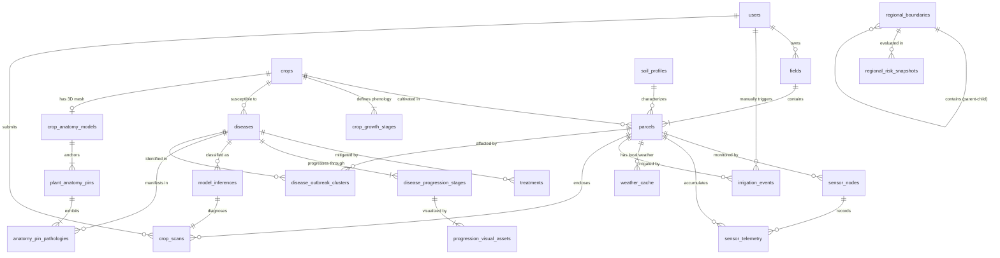

# Precision AgriTech Platform - Complete Master Database Schema

> **Document Type:** System Specification / Master Database Architecture  
> **Database Engine:** PostgreSQL 16+ with PostGIS 3.4+ Extension  
> **Coordinate Reference System:** WGS 84 (`EPSG:4326`)  
> **Target Application:** Precision AgriTech Field Operations, Automated Telemetry Irrigation & Crop Diagnostics Platform  

---

## 1. Executive Architectural Overview

The **Precision AgriTech Platform** bridges micro-level field precision agriculture (individual parcel geometries, diurnal IoT probe telemetry, automated FAO-56 irrigation actuation, and foliar disease diagnosis) with macro-level geospatial risk modeling (Türkiye regional/provincial agro-climatic stress mapping).

### Key Architectural Tenets:
1. **Spatial Representation (PostGIS):**
   - Geodetic spatial reference: **WGS 84 (`EPSG:4326`)** representing standard longitude/latitude coordinates.
   - Geodesic computations (e.g., surface area in hectares, boundary perimeters, clustering distance metrics) are calculated using PostGIS `geography` casts or planar projection transforms.
   - **GiST (Generalized Search Tree)** spatial indexes are applied across all geometric columns (`GEOMETRY(Polygon, 4326)`, `GEOMETRY(Point, 4326)`, `GEOMETRY(MultiPolygon, 4326)`).
2. **Dynamic Mathematical Grounding:**
   - **FAO-56 Penman-Monteith Water Deficit Model:** Dynamically calculated root-zone water balance driven by phenological crop coefficients ($K_c$), reference evapotranspiration ($ET_0$), effective precipitation ($P_{eff}$), and soil hydraulic profiles.
   - **Spatial Outbreak Clustering (DBSCAN):** Density-based clustering of geotagged disease inspections identifying pathogen contagion boundaries.
   - **Macro Risk Indexing:** Continuous composite scoring across fungal disease pressure, thermal drought strain, and unseasonal vernal frost.
3. **Data Integrity & Normalization:**
   - Strict foreign key constraints with explicit referential action rules (`ON DELETE CASCADE`, `ON DELETE RESTRICT`, `ON DELETE SET NULL`).
   - High-volume time-series telemetry isolated into optimized, sequentially indexed structures suitable for time-range partitioning.

---

## 2. Master Domain Capability Map & Relational Architecture

The platform's relational and spatial schema is structured into **9 functional domain modules**:

```
 ┌─────────────────────────┐     ┌─────────────────────────┐     ┌─────────────────────────┐
 │   1. Identity & Farm    │     │    2. Soil & Crop       │     │   3. Plant Pathology    │
 │       Management        │     │       Master Data       │     │   & Progression Engine  │
 │  (users, fields,        │     │ (soil_profiles, crops,  │     │ (diseases, treatments,  │
 │   parcels)              │     │  crop_growth_stages)    │     │  progression_stages...) │
 └────────────┬────────────┘     └────────────┬────────────┘     └────────────┬────────────┘
              │                               │                               │
              ▼                               ▼                               ▼
 ┌─────────────────────────┐     ┌─────────────────────────┐     ┌─────────────────────────┐
 │  4. 3D Plant Anatomy    │     │   5. IoT Probes &       │     │  6. Weather & FAO-56    │
 │       Explorer          │     │    Telemetry Stream     │     │    Irrigation Engine    │
 │ (crop_anatomy_models,   │     │ (sensor_nodes,          │     │ (weather_cache,         │
 │  plant_anatomy_pins...) │     │  sensor_telemetry)      │     │  irrigation_events)     │
 └────────────┬────────────┘     └────────────┬────────────┘     └────────────┬────────────┘
              │                               │                               │
              ▼                               ▼                               ▼
 ┌─────────────────────────┐     ┌─────────────────────────┐     ┌─────────────────────────┐
 │   7. Field Scans &      │     │   8. Türkiye Macro      │     │   9. Presentation &     │
 │    Vision Inference     │     │    Geospatial Risk      │     │   Evaluation Fixtures   │
 │ (crop_scans,            │     │ (regional_boundaries,   │     │ (demo_scenarios)        │
 │  model_inferences...)   │     │  regional_risk_snaps...)│     │                         │
 └─────────────────────────┘     └─────────────────────────┘     └─────────────────────────┘
```

---

## 3. Master Entity-Relationship Diagram (Mermaid)



---

## 4. Comprehensive Entity Specifications by Domain Module

### Module 1: Identity & Farm Management

#### 1.1 `users`
Represents farm operators, agronomists, field workers, and platform administrators.

| Column         | Type / Representation | Constraints               | Description                                               |
| :------------- | :-------------------- | :------------------------ | :-------------------------------------------------------- |
| `id`           | `UUID`                | Primary Key               | Unique user identifier                                    |
| `email`        | `VARCHAR(255)`        | Unique, Not Null          | Account login and contact address                         |
| `full_name`    | `VARCHAR(120)`        | Not Null                  | User full legal/display name                              |
| `role`         | `VARCHAR(30)`         | Not Null                  | Role: `FARM_OWNER`, `AGRONOMIST`, `FIELD_WORKER`, `ADMIN` |
| `phone_number` | `VARCHAR(30)`         | Nullable                  | Field worker contact for urgent alerts                    |
| `is_active`    | `BOOLEAN`             | Not Null, Default `TRUE`  | Account status flag                                       |
| `made_at`      | `TIMESTAMPTZ`         | Not Null, Default `NOW()` | Registration timestamp                                    |
| `updated_at`   | `TIMESTAMPTZ`         | Not Null, Default `NOW()` | Profile change timestamp                                  |

#### 1.2 `fields`
Represents an overarching agricultural landholding or farm perimeter boundary.

| Column | Type / Representation | Constraints | Description |
| :--- | :--- | :--- | :--- |
| `id` | `UUID` | Primary Key | Unique property identifier |
| `owner_id` | `UUID` | FK (`users.id`) ON DELETE CASCADE, Not Null | Farm operator or managing owner |
| `name` | `VARCHAR(120)` | Not Null | Farm or field title (e.g., "Bursa Çeltikçi Çiftliği") |
| `boundary_geom` | `GEOMETRY(Polygon, 4326)` | Not Null | Outer perimeter boundary polygon |
| `total_area_hectares`| `NUMERIC(8, 2)` | Not Null | Calculated geographic area in hectares |
| `location_name` | `VARCHAR(150)` | Nullable | Administrative address / district (e.g., "Mustafakemalpaşa, Bursa") |
| `made_at` | `TIMESTAMPTZ` | Not Null, Default `NOW()` | making timestamp |
| `updated_at` | `TIMESTAMPTZ` | Not Null, Default `NOW()` | Update timestamp |

#### 1.3 `parcels`
Represents individual zoned agricultural management blocks inside a field, assigned to a specific crop and soil profile.

| Column | Type / Representation | Constraints | Description |
| :--- | :--- | :--- | :--- |
| `id` | `UUID` | Primary Key | Unique parcel zone identifier |
| `field_id` | `UUID` | FK (`fields.id`) ON DELETE CASCADE, Not Null | Parent field perimeter |
| `crop_id` | `UUID` | FK (`crops.id`) ON DELETE RESTRICT, Not Null | Cultivated crop variety |
| `soil_profile_id` | `VARCHAR(40)` | FK (`soil_profiles.id`) ON DELETE RESTRICT, Not Null | Associated soil texture class |
| `name` | `VARCHAR(80)` | Not Null | Zone title (e.g., "North Block - Industrial Tomato") |
| `boundary_geom` | `GEOMETRY(Polygon, 4326)` | Not Null | Spatial boundary polygon of the parcel |
| `area_hectares` | `NUMERIC(8, 2)` | Not Null | Calculated surface area in hectares |
| `planting_date` | `DATE` | Not Null | Sowing or transplanting date |
| `kc_current` | `NUMERIC(3, 2)` | Not Null, Default `0.40` | Current FAO-56 crop coefficient factor |
| `irrigation_method`| `VARCHAR(30)` | Not Null, Default `'DRIP'` | Method: `DRIP`, `SPRINKLER`, `MICRO_JET` |
| `system_flow_rate_lpm`| `NUMERIC(8, 2)` | Not Null, Default `100.00` | Water delivery flow rate (Liters per minute) |
| `irrigation_efficiency`| `NUMERIC(3, 2)` | Not Null, Default `0.88` | Application efficiency factor $\eta \in [0.70, 0.95]$ |
| `made_at` | `TIMESTAMPTZ` | Not Null, Default `NOW()` | making timestamp |
| `updated_at` | `TIMESTAMPTZ` | Not Null, Default `NOW()` | Update timestamp |

---

### Module 2: Soil & Agronomic Master Data

#### 2.1 `soil_profiles`
Maintains physical and hydrological reference parameters per soil texture class.

| Column | Type / Representation | Constraints | Description |
| :--- | :--- | :--- | :--- |
| `id` | `VARCHAR(40)` | Primary Key | Soil code: `sandy_loam`, `clay`, `silt_loam`, `loam` |
| `name` | `VARCHAR(80)` | Not Null | Display name (e.g., "Kumlu Tın (Sandy Loam)") |
| `field_capacity_pct` | `NUMERIC(4, 3)` | Not Null | $\theta_{FC}$ volumetric water content at field capacity ($m^3/m^3$) |
| `wilting_point_pct` | `NUMERIC(4, 3)` | Not Null | $\theta_{WP}$ volumetric water content at permanent wilting point |
| `saturation_pct` | `NUMERIC(4, 3)` | Not Null | Total soil porosity saturation capacity |
| `hydraulic_conductivity`| `NUMERIC(6, 2)` | Not Null | Saturated hydraulic conductivity / drainage rate (mm/hr) |
| `mad_threshold_pct` | `NUMERIC(3, 2)` | Not Null, Default `0.50` | Management Allowed Depletion fraction $p \in [0.3, 0.6]$ |

#### 2.2 `crops`
Catalog of crop varieties supported by the platform, vision models, and irrigation schedules.

| Column | Type / Representation | Constraints | Description |
| :--- | :--- | :--- | :--- |
| `id` | `UUID` | Primary Key | Unique crop identifier |
| `common_name` | `VARCHAR(80)` | Unique, Not Null | e.g., "Tomato", "Potato", "Corn", "Apple" |
| `scientific_name` | `VARCHAR(120)` | Nullable | Botanical binomial (e.g., *Solanum lycopersicum*) |
| `family` | `VARCHAR(80)` | Nullable | Plant family (e.g., *Solanaceae*, *Poaceae*) |
| `default_root_depth_max_m`| `NUMERIC(3, 2)` | Not Null, Default `0.60` | Maximum effective rooting depth $Z_r$ at maturity (meters) |
| `made_at` | `TIMESTAMPTZ` | Not Null, Default `NOW()` | making timestamp |

#### 2.3 `crop_growth_stages`
Configures phenological development stage durations and $K_c$ coefficients for FAO-56 calculations.

| Column | Type / Representation | Constraints | Description |
| :--- | :--- | :--- | :--- |
| `id` | `UUID` | Primary Key | Unique stage configuration identifier |
| `crop_id` | `UUID` | FK (`crops.id`) ON DELETE CASCADE, Not Null | Associated crop profile |
| `stage_name` | `VARCHAR(30)` | Not Null | `INITIAL`, `DEVELOPMENT`, `MID_SEASON`, `LATE_SEASON` |
| `stage_order` | `INTEGER` | Not Null | Sequence index ($1, 2, 3, 4$) |
| `duration_days` | `INTEGER` | Not Null | Stage length in days ($L_{ini}, L_{dev}, L_{mid}, L_{late}$) |
| `kc_value` | `NUMERIC(3, 2)` | Not Null | Characteristic $K_c$ coefficient ($K_{c,ini}, K_{c,mid}, K_{c,end}$) |
| `root_depth_ratio` | `NUMERIC(3, 2)` | Not Null | Fraction of maximum root depth active during this stage ($0.0 \to 1.0$) |

---

### Module 3: Plant Pathology & Disease Progression Slider (Feature #1)

#### 3.1 `diseases`
Maintains the catalog of foliar conditions, pathologies, and healthy baselines per crop.

| Column | Type / Representation | Constraints | Description |
| :--- | :--- | :--- | :--- |
| `id` | `UUID` | Primary Key | Unique pathology identifier |
| `crop_id` | `UUID` | FK (`crops.id`) ON DELETE CASCADE, Not Null | Target host crop |
| `common_name` | `VARCHAR(100)` | Not Null | e.g., "Early Blight", "Late Blight", "Healthy" |
| `scientific_name` | `VARCHAR(120)` | Nullable | Pathogen taxon (e.g., *Alternaria solani*) |
| `pathogen_type` | `VARCHAR(30)` | Not Null | `FUNGAL`, `BACTERIAL`, `VIRAL`, `PHYSIOLOGICAL`, `HEALTHY` |
| `risk_level` | `VARCHAR(20)` | Not Null | Threat grade: `LOW`, `MEDIUM`, `HIGH`, `CRITICAL` |
| `general_description`| `TEXT` | Not Null | Summary of biological symptoms and tissue degradation |
| `favorable_conditions`| `TEXT` | Nullable | Microclimatic triggers (e.g., $RH > 85\%$, $18^\circ\text{C}\text{--}24^\circ\text{C}$) |

#### 3.2 `treatments`
Actionable agronomic mitigations, spray schedules, and biological protocols.

| Column | Type / Representation | Constraints | Description |
| :--- | :--- | :--- | :--- |
| `id` | `UUID` | Primary Key | Unique treatment protocol identifier |
| `disease_id` | `UUID` | FK (`diseases.id`) ON DELETE CASCADE, Not Null | Target pathology |
| `treatment_type` | `VARCHAR(30)` | Not Null | `CULTURAL`, `BIOLOGICAL`, `CHEMICAL`, `PREVENTATIVE` |
| `title` | `VARCHAR(150)` | Not Null | Protocol heading (e.g., "Copper Hydroxide Protective Barrier") |
| `action_steps` | `TEXT` | Not Null | Detailed dosage, application timing, and interval instructions |
| `active_substances` | `TEXT` | Nullable | Chemical or active biological agents |
| `is_organic_certified`| `BOOLEAN` | Not Null, Default `FALSE` | Flag indicating compliance with organic farming standards |

#### 3.3 `disease_progression_stages`
Defines discrete biological stages along the 0% to 100% infection scale for the WebGL slider.

| Column | Type / Representation | Constraints | Description |
| :--- | :--- | :--- | :--- |
| `id` | `UUID` | Primary Key | Unique progression stage identifier |
| `disease_id` | `UUID` | FK (`diseases.id`) ON DELETE CASCADE, Not Null | Associated disease profile |
| `stage_order` | `INTEGER` | Not Null | Sequence index ($0 = \text{Healthy}, 1 = \text{Early}, 2 = \text{Necrotic}$) |
| `stage_label` | `VARCHAR(80)` | Not Null | e.g., "Asymptomatic Baseline", "Active Lesion Spread", "Tissue Necrosis" |
| `min_slider_pct` | `NUMERIC(5, 2)` | Not Null | Slider activation lower bound (e.g., `0.00`, `30.01`, `70.01`) |
| `max_slider_pct` | `NUMERIC(5, 2)` | Not Null | Slider activation upper bound (e.g., `30.00`, `70.00`, `100.00`) |
| `symptom_markers` | `TEXT` | Not Null | Tooltip text explaining foliar markers at this threshold |
| `agronomic_advice` | `TEXT` | Nullable | Short-form intervention recommendation |

#### 3.4 `progression_visual_assets`
Stores asset metadata and localized masks consumed by the Canvas/WebGL cross-dissolve blend engine.

| Column | Type / Representation | Constraints | Description |
| :--- | :--- | :--- | :--- |
| `id` | `UUID` | Primary Key | Unique visual plate asset identifier |
| `stage_id` | `UUID` | FK (`disease_progression_stages.id`) ON DELETE CASCADE, Not Null | Associated stage |
| `base_image_url` | `TEXT` | Not Null | Aligned high-resolution leaf plate URL |
| `mask_image_url` | `TEXT` | Nullable | Alpha / high-pass edge mask for shader chlorosis transition |
| `color_palette_hex` | `VARCHAR(100)` | Nullable | Comma-separated hex accents for symptom callouts |

---

### Module 4: 3D Plant Anatomy Explorer (Feature #2)

#### 4.1 `crop_anatomy_models`
Stores Draco-compressed 3D glTF/GLB asset metadata and camera bounds per crop.

| Column | Type / Representation | Constraints | Description |
| :--- | :--- | :--- | :--- |
| `id` | `UUID` | Primary Key | Unique 3D model asset identifier |
| `crop_id` | `UUID` | FK (`crops.id`) ON DELETE CASCADE, Not Null, Unique | 1:1 association with host crop |
| `model_file_url` | `TEXT` | Not Null | Storage bucket URL to optimized `.glb` asset |
| `file_size_bytes` | `INTEGER` | Not Null | Compressed payload size ($\le 3.5\text{ MB}$) |
| `triangle_count` | `INTEGER` | Not Null | Triangular face count ($\le 45{,}000$) |
| `draco_compressed` | `BOOLEAN` | Not Null, Default `TRUE` | Draco compression flag |
| `default_camera_settings`| `JSONB` | Nullable | JSON camera rigging parameters: `target`, `fov`, `polar_limits` |

#### 4.2 `plant_anatomy_pins`
Interactive 3D spatial pins anchored directly to labeled mesh regions.

| Column | Type / Representation | Constraints | Description |
| :--- | :--- | :--- | :--- |
| `id` | `VARCHAR(64)` | Primary Key | Alphanumeric pin ID (e.g., `pin-tom-stem-01`) |
| `model_id` | `UUID` | FK (`crop_anatomy_models.id`) ON DELETE CASCADE, Not Null | Associated 3D crop model |
| `zone_code` | `VARCHAR(30)` | Not Null | `FOLIAGE_UPPER`, `STEM_VASCULAR`, `ROOT_COLLAR`, `FRUIT_CALYX` |
| `zone_name` | `VARCHAR(80)` | Not Null | Human-readable region (e.g., "Stem / Vascular Bundle") |
| `coord_x` | `NUMERIC(7, 4)` | Not Null | Normalized 3D X coordinate in local model space |
| `coord_y` | `NUMERIC(7, 4)` | Not Null | Normalized 3D Y coordinate in local model space |
| `coord_z` | `NUMERIC(7, 4)` | Not Null | Normalized 3D Z coordinate in local model space |
| `description` | `TEXT` | Not Null | Anatomical role and agronomic description |

#### 4.3 `anatomy_pin_pathologies`
Associates interactive 3D pins with specific internal and external disease manifestations.

| Column | Type / Representation | Constraints | Description |
| :--- | :--- | :--- | :--- |
| `id` | `UUID` | Primary Key | Unique association identifier |
| `pin_id` | `VARCHAR(64)` | FK (`plant_anatomy_pins.id`) ON DELETE CASCADE, Not Null | Anchored anatomical hotspot |
| `disease_id` | `UUID` | FK (`diseases.id`) ON DELETE CASCADE, Not Null | Manifesting disease pathology |
| `internal_symptom` | `TEXT` | Not Null | Vascular / xylem browning, pith breakdown |
| `external_symptom` | `TEXT` | Not Null | Foliar chlorosis, unilateral wilting, stem lesions |
| `histological_description`| `TEXT` | Nullable | Cellular/vascular invasion mechanism |
| `microscopic_image_url`| `TEXT` | Nullable | URL to histology cross-section photo |

---

### Module 5: IoT Probes, Sensor Telemetry & Simulation Engine

#### 5.1 `sensor_nodes`
Tracks physical and virtual IoT telemetry collection probes pinned to parcels.

| Column | Type / Representation | Constraints | Description |
| :--- | :--- | :--- | :--- |
| `id` | `UUID` | Primary Key | Unique sensor node identifier |
| `parcel_id` | `UUID` | FK (`parcels.id`) ON DELETE CASCADE, Not Null | Enclosing spatial parcel |
| `hardware_uid` | `VARCHAR(64)` | Unique, Not Null | Unique MAC / Serial / Virtual Simulator UID |
| `name` | `VARCHAR(80)` | Not Null | Probe name (e.g., "Probe #1 - South Corner") |
| `geom_point` | `GEOMETRY(Point, 4326)` | Not Null | Pinned geographic coordinate |
| `is_virtual` | `BOOLEAN` | Not Null, Default `TRUE` | Distinguishes physical vs. simulated IoT probes |
| `status` | `VARCHAR(20)` | Not Null, Default `'ACTIVE'` | Probe state: `ACTIVE`, `OFFLINE`, `MAINTENANCE` |
| `battery_level_pct` | `NUMERIC(4, 1)` | Nullable | Latest battery charge percentage |
| `installed_at` | `TIMESTAMPTZ` | Not Null, Default `NOW()` | Deployment timestamp |
| `last_telemetry_at`| `TIMESTAMPTZ` | Nullable | Timestamp of most recent telemetry stream tick |

#### 5.2 `sensor_telemetry`
High-throughput time-series table logging soil moisture, soil temperature, and probe health.

| Column | Type / Representation | Constraints | Description |
| :--- | :--- | :--- | :--- |
| `id` | `BIGSERIAL` | Primary Key | Auto-incrementing 64-bit sequence ID |
| `parcel_id` | `UUID` | FK (`parcels.id`) ON DELETE CASCADE, Not Null | Target spatial parcel |
| `node_id` | `UUID` | FK (`sensor_nodes.id`) ON DELETE CASCADE, Not Null | Generating hardware/virtual node |
| `timestamp` | `TIMESTAMPTZ` | Not Null | Telemetry capture timestamp |
| `soil_moisture_pct` | `NUMERIC(5, 2)` | Not Null | Volumetric water content percentage ($\text{VWC}\%$) |
| `soil_temp_c` | `NUMERIC(4, 2)` | Not Null | Soil temperature in Celsius |
| `ambient_humidity_pct`| `NUMERIC(4, 1)` | Nullable | Ambient relative humidity percentage |
| `battery_voltage` | `NUMERIC(3, 2)` | Not Null | Node battery voltage (e.g., $3.95\text{ V}$) |

---

### Module 6: Meteorology & FAO-56 Irrigation Actuation Engine

#### 6.1 `weather_cache`
Stores cached external Open-Meteo meteorological feeds (observed and 7-day rolling forecasts).

| Column | Type / Representation | Constraints | Description |
| :--- | :--- | :--- | :--- |
| `id` | `UUID` | Primary Key | Cache record identifier |
| `parcel_id` | `UUID` | FK (`parcels.id`) ON DELETE CASCADE, Not Null | Centroid-linked parcel |
| `forecast_date` | `DATE` | Not Null | Target observation or forecast day |
| `is_forecast` | `BOOLEAN` | Not Null, Default `FALSE` | Flag: observed historical vs. predictive forecast |
| `et0_mm` | `NUMERIC(5, 2)` | Not Null | Reference evapotranspiration ($ET_0$, mm/day) |
| `precipitation_mm` | `NUMERIC(5, 2)` | Not Null | Total precipitation (mm) |
| `effective_precipitation_mm`| `NUMERIC(5, 2)` | Not Null | Effective rainfall ($P_{eff} = \max(0, (P - 5) \times 0.75)$) |
| `temp_min_c` | `NUMERIC(4, 1)` | Not Null | Minimum daily temperature (°C) |
| `temp_max_c` | `NUMERIC(4, 1)` | Not Null | Maximum daily temperature (°C) |
| `relative_humidity_avg_pct`| `NUMERIC(4, 1)` | Nullable | Average daily relative humidity (%) |
| `solar_radiation_mj`| `NUMERIC(6, 2)` | Nullable | Shortwave radiation sum ($\text{MJ}/\text{m}^2$) |
| `wind_speed_ms` | `NUMERIC(4, 1)` | Nullable | Mean wind speed at 10m (m/s) |
| `ingested_at` | `TIMESTAMPTZ` | Not Null, Default `NOW()` | Ingestion timestamp |

#### 6.2 `irrigation_events`
Tracks the complete valve actuation lifecycle from threshold trigger to completion.

| Column | Type / Representation | Constraints | Description |
| :--- | :--- | :--- | :--- |
| `id` | `UUID` | Primary Key | Event record identifier |
| `parcel_id` | `UUID` | FK (`parcels.id`) ON DELETE CASCADE, Not Null | Target parcel |
| `trigger_type` | `VARCHAR(30)` | Not Null | `AUTOMATED_DEFICIT`, `MANUAL_OVERRIDE`, `SCHEDULED_RECIPE` |
| `status` | `VARCHAR(20)` | Not Null | `PENDING`, `IN_PROGRESS`, `COMPLETED`, `ABORTED` |
| `deficit_depth_mm`| `NUMERIC(5, 2)` | Not Null | Calculated root-zone depletion $D_r$ at trigger |
| `scheduled_start`| `TIMESTAMPTZ` | Not Null | Scheduled valve opening timestamp |
| `actual_start` | `TIMESTAMPTZ` | Nullable | Exact valve actuation start timestamp |
| `completed_at` | `TIMESTAMPTZ` | Nullable | Exact valve closure timestamp |
| `duration_minutes`| `INTEGER` | Not Null | Planned/actual duration in minutes |
| `water_volume_liters`| `NUMERIC(10, 2)` | Not Null | Calculated/delivered gross water volume in Liters |
| `flow_rate_lpm` | `NUMERIC(8, 2)` | Not Null | Flow rate during event |
| `reason` | `VARCHAR(150)` | Nullable | Trigger reason (e.g., "MAD_EXCEEDED_DEFICIT_RECOVERY") |
| `triggered_by_user_id`| `UUID` | FK (`users.id`) ON DELETE SET NULL, Nullable | Operator user ID if manual override |
| `made_at` | `TIMESTAMPTZ` | Not Null, Default `NOW()` | Event making timestamp |

---

### Module 7: In-Field Mobile Inspections, Vision Inference & Outbreak Clusters

#### 7.1 `model_inferences`
Operational and audit log recording every leaf scan processed by the FastAPI vision microservice.

| Column | Type / Representation | Constraints | Description |
| :--- | :--- | :--- | :--- |
| `id` | `UUID` | Primary Key | Unique inference run identifier |
| `predicted_disease_id`| `UUID` | FK (`diseases.id`) ON DELETE RESTRICT, Not Null | Top predicted disease class |
| `model_version` | `VARCHAR(50)` | Not Null | e.g., `mobilenetv3_large_v1.0.0` |
| `confidence_score`| `NUMERIC(5, 4)` | Not Null | Classifier confidence score ($0.0000 \to 1.0000$) |
| `class_probabilities`| `JSONB` | Not Null | Softmax probability distribution across all classes |
| `inference_time_ms`| `INTEGER` | Not Null | Model inference execution latency in milliseconds |
| `made_at` | `TIMESTAMPTZ` | Not Null, Default `NOW()` | Inference execution timestamp |

#### 7.2 `crop_scans`
Stores in-field visual diagnosis records linked via spatial containment (`ST_Contains`).

| Column | Type / Representation | Constraints | Description |
| :--- | :--- | :--- | :--- |
| `id` | `UUID` | Primary Key | Unique diagnostic scan identifier |
| `parcel_id` | `UUID` | FK (`parcels.id`) ON DELETE SET NULL, Nullable | Auto-associated parcel resolved by coordinate |
| `inference_id` | `UUID` | FK (`model_inferences.id`) ON DELETE CASCADE, Not Null | Linked vision inference output |
| `uploaded_by_user_id`| `UUID` | FK (`users.id`) ON DELETE SET NULL, Nullable | Field worker who captured the sample |
| `image_url` | `TEXT` | Not Null | Storage bucket URL of original leaf photo |
| `geom_point` | `GEOMETRY(Point, 4326)` | Not Null | Photo capture geographic coordinate |
| `gps_accuracy_meters`| `NUMERIC(5, 2)` | Nullable | Hardware GPS estimated horizontal accuracy radius |
| `detection_source`| `VARCHAR(30)` | Not Null, Default `'EXIF_GPS'` | Source: `EXIF_GPS`, `DEVICE_NAVIGATOR`, `MANUAL_PIN` |
| `field_notes` | `TEXT` | Nullable | Operator remarks regarding local plant state |
| `scanned_at` | `TIMESTAMPTZ` | Not Null, Default `NOW()` | Field photo upload timestamp |

#### 7.3 `disease_outbreak_clusters`
Aggregated spatial clusters produced by DBSCAN identifying contagion hotspots across parcels.

| Column | Type / Representation | Constraints | Description |
| :--- | :--- | :--- | :--- |
| `id` | `UUID` | Primary Key | Unique cluster identifier |
| `parcel_id` | `UUID` | FK (`parcels.id`) ON DELETE CASCADE, Not Null | Enclosing primary parcel |
| `disease_id` | `UUID` | FK (`diseases.id`) ON DELETE CASCADE, Not Null | Pathogen condition driving the cluster |
| `cluster_polygon`| `GEOMETRY(Polygon, 4326)` | Not Null | Convex hull spatial envelope enclosing cluster points |
| `infection_count`| `INTEGER` | Not Null | Number of distinct high-confidence positive scans |
| `avg_confidence` | `NUMERIC(5, 4)` | Not Null | Mean confidence score across cluster points |
| `severity_level` | `VARCHAR(20)` | Not Null | Cluster rating: `MODERATE`, `HIGH`, `CRITICAL` |
| `status` | `VARCHAR(20)` | Not Null, Default `'ACTIVE'` | State: `ACTIVE`, `CONTAINED`, `RESOLVED` |
| `first_detected_at`| `TIMESTAMPTZ` | Not Null | Timestamp of earliest scan in cluster |
| `last_detected_at` | `TIMESTAMPTZ` | Not Null | Timestamp of most recent scan in cluster |
| `lock_overhead_irrigation`| `BOOLEAN` | Not Null, Default `TRUE` | Safety lockout flag halting overhead watering |

---

### Module 8: Macro Agro-Climate Regional Risk Engine (Feature #3)

#### 8.1 `regional_boundaries`
Maintains simplified spatial vector boundaries for Türkiye's 7 agricultural regions and 81 provinces.

| Column | Type / Representation | Constraints | Description |
| :--- | :--- | :--- | :--- |
| `id` | `VARCHAR(32)` | Primary Key | e.g., `TR-MARMARA`, `TR-16-BURSA` |
| `admin_level` | `VARCHAR(16)` | Not Null | Administrative level: `REGION` (7 zones) or `PROVINCE` (81 il) |
| `parent_region_id`| `VARCHAR(32)` | FK (`regional_boundaries.id`) ON DELETE SET NULL, Nullable | Parent macro-region (for provinces) |
| `name_tr` | `VARCHAR(80)` | Not Null | Official Turkish name (e.g., "Marmara Bölgesi", "Bursa") |
| `plate_code` | `INTEGER` | Nullable | Province traffic code ($1 \to 81$, null for regions) |
| `centroid_point` | `GEOMETRY(Point, 4326)` | Not Null | Representative spatial point for meteorological sampling |
| `boundary_geom` | `GEOMETRY(MultiPolygon, 4326)` | Not Null | Simplified boundary geometry (Douglas-Peucker) |

#### 8.2 `regional_risk_snapshots`
Daily computed macro-climatic agro-risk scores and preventative advisories.

| Column | Type / Representation | Constraints | Description |
| :--- | :--- | :--- | :--- |
| `id` | `UUID` | Primary Key | Snapshot record identifier |
| `region_id` | `VARCHAR(32)` | FK (`regional_boundaries.id`) ON DELETE CASCADE, Not Null | Target geographic zone |
| `assessment_date`| `DATE` | Not Null | Calculation date |
| `fungal_risk_score`| `NUMERIC(4, 1)` | Not Null | $R_{fungal} \in [0.0, 100.0]$ |
| `drought_risk_score`| `NUMERIC(4, 1)` | Not Null | $R_{drought} \in [0.0, 100.0]$ |
| `frost_risk_score` | `NUMERIC(4, 1)` | Not Null | $R_{frost} \in [0.0, 100.0]$ |
| `dominant_threat` | `VARCHAR(32)` | Not Null | Primary stressor: `FUNGAL`, `DROUGHT`, `FROST`, `NONE` |
| `overall_risk_level`| `VARCHAR(20)` | Not Null | Categorical grade: `LOW`, `MODERATE`, `SEVERE` |
| `color_hex` | `VARCHAR(7)` | Not Null | Direct map styling: `#10B981`, `#F59E0B`, `#EF4444` |
| `vulnerable_crops`| `TEXT[]` | Not Null | Array of at-risk crops (e.g., `{"Apple", "Tomato", "Wheat"}`) |
| `climate_anomalies`| `JSONB` | Not Null | JSON of observed anomalies ($RH_{avg}$, $T_{mean}$, consecutive wet hours) |
| `advisory_payload`| `JSONB` | Not Null | Structured agronomic advisories and preventative sprays |
| `computed_at` | `TIMESTAMPTZ` | Not Null, Default `NOW()` | Record computation timestamp |

---

### Module 9: Presentation & Evaluation Control Fixtures (Demo Triggers)

#### 9.1 `demo_scenarios`
Configuration fixtures enabling evaluators to inject deterministic edge cases during capstone defense.

| Column | Type / Representation | Constraints | Description |
| :--- | :--- | :--- | :--- |
| `id` | `VARCHAR(50)` | Primary Key | e.g., `moisture_deficit`, `late_blight_outbreak`, `regional_heatwave` |
| `name` | `VARCHAR(100)` | Not Null | Human-readable title (e.g., "Accelerate Moisture Depletion") |
| `description` | `TEXT` | Not Null | Summary of injected parameters and observable system reaction |
| `target_entity_type`| `VARCHAR(30)` | Not Null | Target entity scope: `PARCEL`, `REGION`, `FARM` |
| `injection_parameters`| `JSONB` | Not Null | State parameters injected (e.g., `{"forced_moisture_pct": 14.2}`) |
| `is_active` | `BOOLEAN` | Not Null, Default `FALSE` | Active toggle flag |
| `activated_at` | `TIMESTAMPTZ` | Nullable | Activation timestamp |

---

## 5. Indexing & Optimization Strategy

To guarantee sub-second query performance under high spatial and time-series loads, explicit indexing is applied across three categories:

### 1. Spatial Indexes (GiST)
PostGIS spatial columns utilize Generalized Search Tree indexing:
- `fields(boundary_geom)`
- `parcels(boundary_geom)`
- `sensor_nodes(geom_point)`
- `crop_scans(geom_point)`
- `disease_outbreak_clusters(cluster_polygon)`
- `regional_boundaries(boundary_geom)`
- `regional_boundaries(centroid_point)`

### 2. Time-Series & Composite Indexes (B-Tree)
- `sensor_telemetry(parcel_id, timestamp DESC)`: Supports instant rendering of parcel moisture time-series charts.
- `weather_cache(parcel_id, forecast_date)` (Unique): Eliminates redundant ingestion while guaranteeing fast daily weather lookups.
- `regional_risk_snapshots(region_id, assessment_date)` (Unique): Guarantees one risk snapshot per region per day.
- `crop_scans(parcel_id, scanned_at DESC)`: Rapid retrieval of recent field inspections per parcel.

### 3. Partitioning Strategy for High-Throughput Telemetry
For production scaling, `sensor_telemetry` is architected for **RANGE Partitioning by Month** based on the `timestamp` column:
- `sensor_telemetry_2026_09`
- `sensor_telemetry_2026_10`
- `sensor_telemetry_2026_11`

This isolates bulk writes and ensures historical queries do not scan table locks across older data blocks.

---

## 6. Spatial Integrity Rules & Automated Database Triggers

### 1. Geodesic Surface Area Calculation Trigger
Whenever a `boundary_geom` is inserted or edited in `fields` or `parcels`, the database calculates and writes `area_hectares` dynamically using geodetic spatial math:

$$\text{Area (ha)} = \frac{\text{ST\_Area}(\text{boundary\_geom}::\text{geography})}{10{,}000}$$

### 2. Spatial Containment Resolution (`ST_Contains`)
When a field worker submits an in-field crop scan with $(X_{\text{lng}}, Y_{\text{lat}})$, or when a sensor probe is deployed:
```
Enclosing Parcel = First parcel WHERE ST_Contains(parcels.boundary_geom, ST_SetSRID(ST_MakePoint(lng, lat), 4326))
```
If coordinates fall outside managed parcels, `parcel_id` is assigned `NULL` without failing the upload transaction.

### 3. Parcel Overlap & Boundary Collision Prevention
To enforce cadastral validity, new or updated parcels within the same parent field must not overlap pre-existing parcels:
```
Condition: ST_Overlaps(boundary_geom, new_parcel_geom) = FALSE (for all parcels WHERE field_id = :fieldId)
```

### 4. DBSCAN Outbreak Spatial Clustering
Active outbreaks are generated dynamically across rolling 14-day scans using PostGIS density clustering:
```
ST_ClusterDBSCAN(geom_point::geography, eps := 50, minpoints := 3) OVER ()
```
- $\text{eps} = 50\text{ meters}$
- $\text{minpoints} = 3\text{ infections}$
- Pathogen clusters automatically generate a convex hull polygon (`ST_ConvexHull`) saved to `disease_outbreak_clusters`.

---

## 7. Cross-Phase End-to-End Data Flow Scenarios

### Scenario A: Mobile Field Inspection & Outbreak Alert (Phase 1 + Phase 2 + Phase 6)
1. **Capture:** Field worker uses mobile PWA (`<input type="file" capture="environment">`) to photograph a diseased tomato leaf.
2. **Metadata Extraction:** Client extracts EXIF GPS $(28.9752, 41.0243)$ or falls back to navigator geolocation.
3. **Gateway Ingestion:** Web API sends the image payload to the Python ML microservice (`POST /api/v1/classify-leaf`).
4. **Model Inference:** ONNX Runtime processes the image in $<85\text{ms}$, returning *Late Blight* with $96.4\%$ confidence. Writes to `model_inferences`.
5. **Spatial Resolution:** PostGIS evaluates `ST_Contains` on `parcels` table and associates `parcel_id = 'parcel-tomato-01'`.
6. **Persistence:** Ingestion writes to `crop_scans`.
7. **Clustering & Alert:** Spatial job detects $\ge 3$ Late Blight scans within $50\text{m}$, making a record in `disease_outbreak_clusters` with `lock_overhead_irrigation = TRUE`.
8. **Real-time Broadcast:** SignalR hub pushes marker and red cluster polygon to the desktop farm dashboard.

### Scenario B: Telemetry Decay & Automated FAO-56 Irrigation Trigger (Phase 2 + Phase 3 + Phase 6)
1. **Weather Ingestion:** Daily background worker queries Open-Meteo for parcel centroid, updating `weather_cache` with $ET_0 = 5.4\text{ mm/day}$ and $P = 0\text{ mm}$.
2. **Dynamic $K_c$ Calculation:** The system determines the crop is 62 Days After Planting (DAP), falling into the Mid-Season stage from `crop_growth_stages`. Dynamic $K_c$ resolves to $1.15$.
3. **Crop Evapotranspiration:** $ET_c = 1.15 \times 5.4 = 6.21\text{ mm/day}$.
4. **Soil Telemetry Decay:** Virtual IoT probe publishes hourly telemetry over MQTT (`agri/telemetry/{parcel_id}`), decreasing volumetric soil moisture from $26\%$ toward wilting threshold. Records persist to `sensor_telemetry`.
5. **Trigger Condition:** Root-zone depletion $D_r$ crosses Readily Available Water (RAW = $28.5\text{ mm}$, MAD threshold tripped).
6. **Actuation Event:** Backend generates an `irrigation_events` record (`status = 'PENDING'`, `water_volume_liters = 14200.0`, `duration_minutes = 45`), and publishes `VALVE_TRIGGER_OPEN` over MQTT.
7. **Feedback Loop:** As the valve runs, virtual sensor telemetry reflects gradual moisture rebound back to Field Capacity.

### Scenario C: Leaf Disease Progression Slider (Feature #1 / Phase 1)
1. **User Interaction:** User opens the inspection tool for Tomato Early Blight (*Alternaria solani*).
2. **Query:** Frontend queries `/api/v1/diseases/{id}/progression-stages` joining `disease_progression_stages` and `progression_visual_assets`.
3. **Asset Buffering:** Three aligned plates ($800 \times 800$ WebP) and high-pass lesion masks are loaded into WebGL texture units.
4. **Scrubbing:** As the user drags the slider from $0 \to 100\%$:
   - $0 \to 30\%$: Interpolates healthy baseline with initial water-soaked lesion chlorosis.
   - $31 \to 70\%$: Cross-dissolves active concentric rings using the alpha mask.
   - $71 \to 100\%$: Accentuates necrotic tissue collapse with biological symptom tooltips from `symptom_markers`.

### Scenario D: 3D Plant Anatomy Dissection (Feature #2 / Phase 4)
1. **Asset Streaming:** User navigates to 3D Anatomy Explorer and selects Corn (*Zea mays*).
2. **Model Load:** Client fetches compressed Draco `.glb` ($<3.5\text{MB}$) via `crop_anatomy_models.model_file_url`.
3. **Pin Placement:** Client queries `plant_anatomy_pins` for that model, projecting 3D normalized coordinates $(X, Y, Z)$ into screen-space HTML buttons with raycasting occlusion checks.
4. **Pin Selection:** User clicks the `STEM_VASCULAR` pin on the lower stalk.
5. **Inspection Drawer:** Camera smoothly animates and zooms to the pin coordinate; slide-over drawer displays `anatomy_pin_pathologies` records showing *Fusarium* stalk rot, internal vascular browning, and microscopic cross-section images.

### Scenario E: Türkiye Regional Agro-Climate Risk Engine (Feature #3 / Phase 5)
1. **Geospatial Boundaries:** Client requests simplified GeoJSON vector boundaries from `regional_boundaries` (7 geographic regions or 81 provinces).
2. **Daily Risk Sync:** Ingestion worker aggregates 14-day trailing and forecast meteorological variables across all regional centroids.
3. **Mathematical Indexing:** Evaluates formulas for $R_{fungal}$, $R_{drought}$, and $R_{frost}$.
4. **Snapshot Persistence:** Writes to `regional_risk_snapshots`. E.g., Karadeniz Region calculates $R_{fungal} = 82.4\%$ ($RH_{avg} = 88.2\%$, $T_{mean} = 19.4^\circ\text{C}$). Dominant threat flagged as `FUNGAL`, color assigned `#EF4444` (Severe).
5. **Interactive Choropleth:** Map applies dynamic fills. Clicking Karadeniz slides open the advisory drawer warning of Apple Scab and Hazelnut Powdery Mildew with preventative copper fungicide recommendations.

---

## 8. Summary of Schema Deliverables

| Entity Name | Domain Module | Primary Key | Key Relationships |
| :--- | :--- | :--- | :--- |
| `users` | 1. Identity & Management | `UUID` | 1:N with `fields`, `crop_scans`, `irrigation_events` |
| `fields` | 1. Identity & Management | `UUID` | N:1 with `users`, 1:N with `parcels` |
| `parcels` | 1. Identity & Management | `UUID` | N:1 with `fields`, `crops`, `soil_profiles`; 1:N with sensors, weather, scans, events |
| `soil_profiles` | 2. Soil Master Data | `VARCHAR(40)` | 1:N with `parcels` |
| `crops` | 2. Crop Master Data | `UUID` | 1:N with `parcels`, `crop_growth_stages`, `diseases`, 1:1 with 3D model |
| `crop_growth_stages` | 2. Crop Master Data | `UUID` | N:1 with `crops` |
| `diseases` | 3. Plant Pathology | `UUID` | N:1 with `crops`; 1:N with `treatments`, `stages`, `inferences`, `pin_pathologies` |
| `treatments` | 3. Plant Pathology | `UUID` | N:1 with `diseases` |
| `disease_progression_stages`| 3. Plant Pathology | `UUID` | N:1 with `diseases`; 1:N with `visual_assets` |
| `progression_visual_assets` | 3. Plant Pathology | `UUID` | N:1 with `disease_progression_stages` |
| `crop_anatomy_models` | 4. 3D Plant Anatomy | `UUID` | 1:1 with `crops`; 1:N with `plant_anatomy_pins` |
| `plant_anatomy_pins` | 4. 3D Plant Anatomy | `VARCHAR(64)` | N:1 with `crop_anatomy_models`; 1:N with `anatomy_pin_pathologies` |
| `anatomy_pin_pathologies` | 4. 3D Plant Anatomy | `UUID` | N:1 with `plant_anatomy_pins`, `diseases` |
| `sensor_nodes` | 5. IoT & Simulation | `UUID` | N:1 with `parcels`; 1:N with `sensor_telemetry` |
| `sensor_telemetry` | 5. IoT & Simulation | `BIGSERIAL` | N:1 with `parcels`, `sensor_nodes` |
| `weather_cache` | 6. Weather & FAO-56 | `UUID` | N:1 with `parcels` |
| `irrigation_events` | 6. Weather & FAO-56 | `UUID` | N:1 with `parcels`, N:1 with `users` (optional) |
| `model_inferences` | 7. Vision & Field Scans | `UUID` | N:1 with `diseases`; 1:1 with `crop_scans` |
| `crop_scans` | 7. Vision & Field Scans | `UUID` | N:1 with `parcels`, `model_inferences`, `users` |
| `disease_outbreak_clusters`| 7. Vision & Field Scans | `UUID` | N:1 with `parcels`, `diseases` |
| `regional_boundaries` | 8. Macro Risk Engine | `VARCHAR(32)` | 1:N recursive parent-child; 1:N with `regional_risk_snapshots` |
| `regional_risk_snapshots` | 8. Macro Risk Engine | `UUID` | N:1 with `regional_boundaries` |
| `demo_scenarios` | 9. Evaluation Fixtures | `VARCHAR(50)` | Standalone parameter fixtures |
